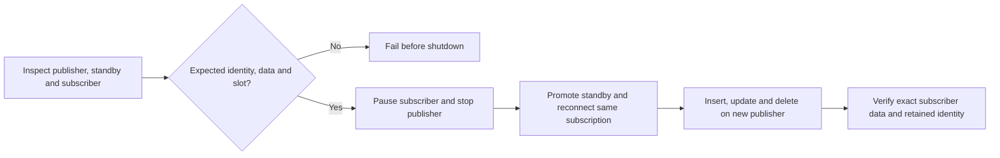

# PostgreSQL subscriber continuity rehearsal

A disposable Kestra workflow that stops an old PostgreSQL publisher, promotes its physical standby, reconnects an existing logical subscriber, and verifies exact insert/update/delete results. A healthy physical standby does not by itself prove that an existing logical subscriber will continue after promotion. This drill makes that outcome observable in Kestra. The blueprint was accepted into Kestra’s official repository for Kestra Hacktober. This companion remains a disposable rehearsal, not a production failover manager.

[Upstream blueprint PR #4791](https://github.com/kestra-io/blueprints/pull/4791) — approved and merged on October 23, 2026. [Official blueprint](https://github.com/kestra-io/blueprints/blob/main/flows/postgres-subscriber-continuity-rehearsal.yaml).

## Run it

Requires Docker Desktop or a compatible Linux Docker engine, Compose, Python 3.9+, and enough space for the pinned images (about 10 GiB was used on this machine). No host Java or Node installation is needed. Port 18080 must be free. The lab uses the dedicated Docker subnet `172.29.77.0/24`; change all lab addresses together if it conflicts with an existing network.

```sh
git clone https://github.com/Cassxbt/kestra-postgres-continuity-rehearsal.git
cd kestra-postgres-continuity-rehearsal
make test
```

The first start initializes Kestra's database and may take several minutes. The
worker/controller connection and API readiness have bounded five-minute startup
allowances. The serial drill uses two worker threads and a 1.5 GiB Java heap;
the tested Docker engine has approximately 4 GiB available. The suite includes
intentional refused executions: their printed Kestra state is
`FAILED`, while the corresponding unittest must say `ok`. The overall command
must finish with `OK` and exit code zero. Only one copy of this fixed-name lab
can run on a Docker engine at a time.

For a single manual demonstration instead of the full fault-injection suite:

```sh
make up
python3 tests/lab_support.py bootstrap
python3 tests/lab_support.py install
```

Use the two system IDs printed by bootstrap as the flow inputs in the local Kestra UI, and explicitly enable disposable-switchover consent. Bootstrap resets this lab's three target databases; it is also the required reset before another demonstration. The tested plugin versions are JDBC PostgreSQL 2.3.0 and Docker 1.7.0.

The tests reset only the `kestra-rehearsal` project's publisher, standby and subscriber containers/volumes. Kestra metadata and execution evidence persist separately. Do not point this fixture at an existing database or use its names for another deployment.

Kestra runs at [localhost:18080](http://localhost:18080). The username is `lab@example.invalid`; the generated password is in the ignored local `.env`. Never copy that file into a PR. Only the Kestra UI port is published, bound to loopback; database ports stay within the lab network. The Docker socket is mounted so the native Stop task can shut down this lab's publisher. This gives the local Kestra worker Docker administration capability; use only the dedicated development setup described here.

To stop the lab without removing its evidence:

```sh
make stop
```

## What the flow does



1. Require explicit disposable-switchover consent.
2. Verify expected publisher/subscriber system identifiers, server roles and fixture data.
3. Require one enabled failover subscription and completed table synchronization.
4. Inspect the candidate standby's identity, replay position and persistent synchronized logical slot.
5. Disable the subscriber, stop the old publisher through the native Docker plugin, then promote the standby through PostgreSQL.
6. Reconnect and enable the existing subscription without recreating it.
7. Execute a real insert, update and delete on the promoted database.
8. Poll the subscriber, require the exact expected rows, and verify the subscription and replication-origin identifiers are unchanged.

This uses native JDBC, Docker, branching, bounded polling and execution outputs. No external service response is mocked and no custom HA controller is introduced. The known three-row fixture is deliberately narrow; it is not a general data-comparison algorithm.

## Evidence and status

- [Independent review guide](REVIEW.md): pinned replay instructions, expected observations and a neutral feedback template. Independent practitioner results are still pending.
- [Clean local replay](evidence/CLEAN-REPLAY.md): ten passing tests from a fresh checkout and fresh metadata/storage; includes two cold-start failures found and fixed. This is not a second-machine replay.
- [Test-first contract](TEST-CONTRACT.md)
- [Original red run](evidence/red-integration.txt): both tests caught the no-op workflow despite its green Kestra status.
- [Wrong-endpoint refusal](evidence/identity-refusal.md): a query reached a different role after container addresses changed; the identity gate refused before shutdown.
- [Reviewed integration report](evidence/TEST-REPORT.md): nine passing tests, ten executions, exact observations, independent review and remaining limits.
- Raw local execution records are under `evidence/raw/` and intentionally ignored. The report links a credential-free summary suitable for review.

The workflow YAML is in `flows/`. Its final `extend` block supplies catalog metadata, which the test installer removes before calling the runtime Flow API. For manual API import, use only the content before that block. The fixture and tests are companion material, not files to add to the upstream blueprint PR outside `flows/`.

## Boundaries

Supported here: an isolated, quiescent PostgreSQL 17.9 publisher/physical standby, one PostgreSQL logical subscriber, one fully synchronized table, a known fixture, and manual PostgreSQL promotion after Docker shutdown of the old publisher.

Not established: production traffic fencing, arbitrary HA managers, zero data loss under concurrent writes, multiple subscribers, incomplete initial table copy, safe automatic retry after a partially completed operation, or operator adoption. There is no automatic rollback after promotion. Any failure from `pause_subscriber` onward requires inspection and explicit lab reset: even a failed shutdown can leave the subscriber disabled. Do not resume or restart individual destructive tasks in Kestra. Reset the three disposable databases through the test/bootstrap fixture before another drill.

Native PostgreSQL already supplies failover slots and readiness checks; pg_auto_failover automates relevant settings. The candidate's proposed value is a reusable rehearsal and observable consumer-continuity evidence in Kestra. Whether maintainers and practitioners want that template remains unvalidated.

## Primary references

- [PostgreSQL 17 logical failover](https://www.postgresql.org/docs/17/logical-replication-failover.html)
- [Slot synchronization prerequisites](https://www.postgresql.org/docs/17/logicaldecoding-explanation.html)
- [Native PostgreSQL Query task](https://kestra.io/plugins/plugin-jdbc-postgres/io.kestra.plugin.jdbc.postgresql.query)
- [Native Docker Stop implementation](https://github.com/kestra-io/plugin-docker/blob/main/src/main/java/io/kestra/plugin/docker/cli/Stop.java)
- [Blueprint contribution contract](https://github.com/kestra-io/blueprints/blob/main/README.md)

## License

Apache-2.0; see [LICENSE](LICENSE). PostgreSQL, Kestra and their images retain their respective licenses.
